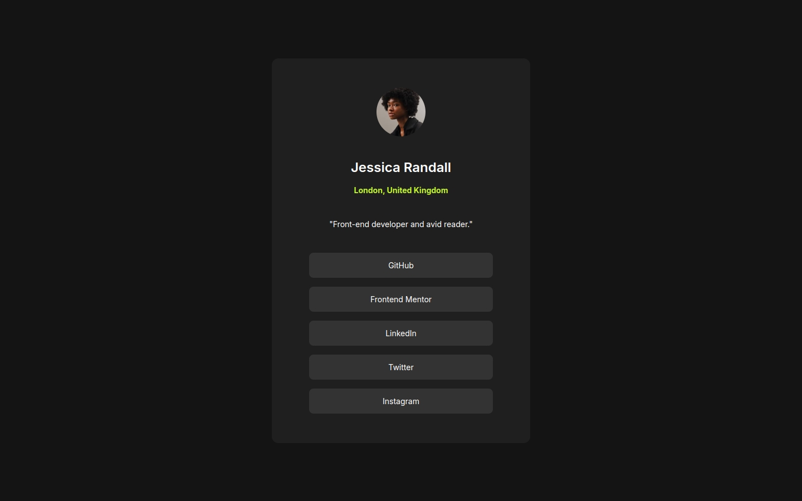

# Frontend Mentor - Social links profile solution

This is a solution to the [Social links profile challenge on Frontend Mentor](https://www.frontendmentor.io/challenges/social-links-profile-UG32l9m6dQ). Frontend Mentor challenges help you improve your coding skills by building realistic projects. 

## Table of contents

- [Overview](#overview)
  - [The challenge](#the-challenge)
  - [Screenshot](#screenshot)
  - [Links](#links)
- [My process](#my-process)
  - [Built with](#built-with)
  - [AI Collaboration](#ai-collaboration)
- [Author](#author)

## Overview

### The challenge

Users should be able to:

- See hover and focus states for all interactive elements on the page

### Screenshot

### Links

- Solution URL: [https://github.com/erdeiviola/fem-social-links-profile.git](https://github.com/erdeiviola/fem-social-links-profile.git)
- Live Site URL: [https://erdeiviola.github.io/fem-social-links-profile/](https://erdeiviola.github.io/fem-social-links-profile/)

## My process

### Built with

- Semantic HTML5 markup
- CSS custom properties

### AI Collaboration

- What tools did you use? : GitHub Copilot
- How did you use them ?  : debugging, brainstorming solutions

## Author

- Frontend Mentor - [@erdeiviola](https://www.frontendmentor.io/profile/erdeiviola)

